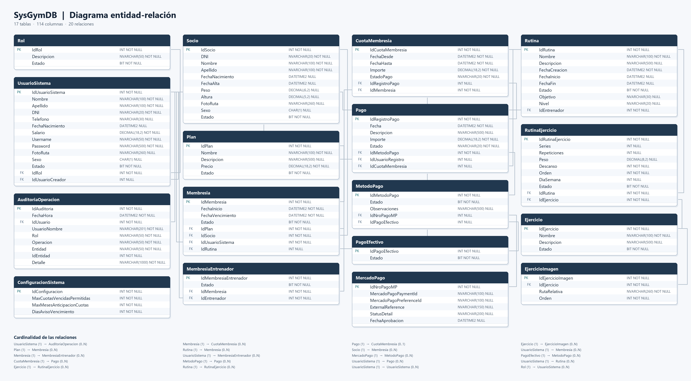

# SysGym

## Especificación de Requisitos de Software

**Taller 2 — UNNE**

**Fecha:** 25 de octubre de 2026

### Integrantes

1. Ferretto Joaquin Daniel 45247702  
2. Leonardo Oscar Canteros 44213011


## 1. Introducción

### 1.1 Propósito

Este documento especifica los requisitos de SysGym, una aplicación de escritorio desarrollada como proyecto universitario de Taller 2. Está dirigido a docentes, estudiantes y personas que participen en su evaluación, uso o mantenimiento.

### 1.2 Alcance

SysGym permite administrar la operación de un gimnasio: usuarios del sistema, socios, planes, membresías, cuotas, pagos, entrenadores, asignaciones, rutinas y ejercicios. También presenta el estado de cuenta de los socios, emite reportes operativos y análisis, registra operaciones de auditoría y exporta determinados comprobantes e informes a PDF.

El sistema registra pagos en efectivo o mediante Mercado Pago como métodos de pago. No inicia cobros ni procesa operaciones mediante la API de Mercado Pago. La aplicación tampoco administra compras, proveedores, inventario ni liquidaciones salariales.

### 1.3 Definiciones y abreviaturas

| Término | Definición |
| --- | --- |
| Socio | Persona registrada para utilizar los servicios del gimnasio. |
| Membresía | Registro que vincula a un socio con un plan y conserva su estado y su historial. |
| Cuota | Importe asociado a un período de una membresía, con su estado de pago. |
| Cuota vencida | Cuota pendiente cuyo período ya finalizó. |
| Límite de deuda | Cantidad de cuotas vencidas permitidas antes de que se inactiven el socio y su membresía. |
| Plan | Modalidad de membresía con nombre, descripción y precio. |
| Entrenador | Usuario del sistema que trabaja con socios y administra rutinas y ejercicios según sus permisos. |
| Rutina | Plan de entrenamiento compuesto por ejercicios organizados por día. |
| Baja lógica | Cambio de estado que deja un registro inactivo y conserva sus datos e historial. |
| Auditoría | Registro de operaciones con su usuario responsable, fecha, entidad y detalle. |
| ERS | Especificación de Requisitos de Software. |
| ORM | Mapeo objeto-relacional: técnica para vincular objetos del programa con datos relacionales. |
| EF6 | Entity Framework 6, herramienta de mapeo objeto-relacional para .NET. |

### 1.4 Referencias

- IEEE, *IEEE Recommended Practice for Software Requirements Specifications*, IEEE Std 830-1998. [Registro en IEEE Xplore](https://ieeexplore.ieee.org/document/720574).
- Microsoft, documentación de [.NET Framework 4.8](https://learn.microsoft.com/en-us/dotnet/framework/get-started/).
- Microsoft, [documentación de Entity Framework 6](https://learn.microsoft.com/en-us/ef/ef6/).

### 1.5 Visión general del documento

La sección 2 describe el producto, sus usuarios y su entorno. La sección 3 enumera los requisitos funcionales y no funcionales y las interfaces. La sección 4 resume el modelo de datos. La sección 5 presenta la arquitectura por capas y la sección 6 indica los requisitos de instalación y ejecución.

## 2. Descripción general

### 2.1 Perspectiva del producto

SysGym es una aplicación de escritorio para Windows. Presenta formularios organizados en paneles según el rol del usuario y persiste la información en SQL Server. El programa está dividido en tres capas: presentación, lógica y acceso a datos; esta última utiliza Entity Framework 6.

### 2.2 Funciones del producto

El producto ofrece las siguientes funciones generales:

- Autenticar usuarios y presentar las opciones correspondientes a su rol.
- Administrar personal, socios, planes, membresías, cuotas y pagos.
- Vincular entrenadores con socios y administrar rutinas y ejercicios.
- Consultar el estado de cuenta de socios, avisos de vencimiento e información general del gimnasio.
- Emitir reportes operativos, analizar indicadores por período y exportar resultados seleccionados a PDF.
- Consultar el registro de operaciones y modificar parámetros generales del sistema.

### 2.3 Características de los usuarios

El sistema contempla tres roles. La tabla resume el acceso disponible desde los paneles de la aplicación.

| Módulo o función | Administrador | Recepcionista | Entrenador |
| --- | --- | --- | --- |
| Usuarios y roles | Sí | No | No |
| Socios y ficha del socio | Sí | Sí | Consulta de sus alumnos |
| Planes | Sí | No | No |
| Membresías y cuotas | Sí | Sí | Consulta de membresías de sus alumnos |
| Pagos | Sí | Sí | No |
| Asignar o consultar entrenadores | Sí | Sí | No |
| Rutinas | Sí | Asigna rutinas modelo por objetivo y nivel | Consulta y gestiona rutinas; modifica las que tiene autorización para editar |
| Ejercicios | Sí | No | Sí |
| Reportes operativos | Sí | Sí | No |
| Análisis general | Sí | No | No |
| Auditoría y configuración | Sí | No | No |

El administrador gestiona el conjunto de módulos administrativos. El recepcionista realiza tareas de atención, cobro y asignación. El entrenador trabaja con sus alumnos y con rutinas y ejercicios.

### 2.4 Restricciones

- La aplicación se ejecuta en Windows y utiliza Windows Forms.
- El entorno de ejecución requerido es .NET Framework 4.8.
- La persistencia requiere SQL Server.
- El acceso a datos se realiza mediante Entity Framework 6.
- La aplicación utiliza formularios y controles estándar de Windows Forms.

### 2.5 Suposiciones y dependencias

- Se dispone de una instancia de SQL Server accesible desde el equipo donde se ejecuta la aplicación.
- La base de datos y los archivos de imágenes necesarios están disponibles para la aplicación.
- Se requiere conexión a internet para consultar el pronóstico del clima y para restaurar los paquetes necesarios durante la preparación del entorno.
- Las funciones principales de gestión no dependen de una conexión a servicios de pago externos.

## 3. Requisitos específicos

### 3.1 Requisitos funcionales

#### Inicio de sesión y roles

- **RF-01.** El sistema debe permitir iniciar sesión con las credenciales de un usuario activo.
- **RF-02.** El sistema debe permitir acceder a las funciones habilitadas para el rol del usuario autenticado.
- **RF-03.** El sistema debe permitir cerrar la sesión actual y cambiar de cuenta.

#### Usuarios

- **RF-04.** El sistema debe permitir consultar, registrar, modificar, dar de baja y reactivar usuarios del sistema.
- **RF-05.** El sistema debe permitir asignar un rol y registrar datos personales y salariales de cada usuario.
- **RF-06.** El sistema debe permitir asociar una fotografía de perfil a un usuario.

#### Socios

- **RF-07.** El sistema debe permitir consultar, registrar, modificar, dar de baja y reactivar socios.
- **RF-08.** El sistema debe permitir buscar socios y consultar sus datos personales, estado, fecha de alta, peso, altura e índice de masa corporal cuando los datos necesarios estén disponibles.
- **RF-09.** El sistema debe permitir asociar o quitar una fotografía del socio.
- Al dar de baja a un socio se inactiva su membresía activa. Al reactivar al socio se ofrece reactivar por separado su membresía, con la validación de deuda habitual; si no tiene membresía, se ofrece crearla. Rechazar cualquiera de las ofertas deja solo al socio activo.

#### Planes

- **RF-10.** El sistema debe permitir consultar, registrar, modificar, dar de baja y reactivar planes.
- **RF-11.** El sistema debe permitir definir el nombre, la descripción y el precio de cada plan.

#### Membresías y cuotas

- **RF-12.** El sistema debe permitir crear y consultar la membresía de un socio y asociarla a un plan; también debe permitir cambiar a un plan activo solo mientras la membresía esté activa, aplicando el precio nuevo a cuotas futuras y conservando el importe de las cuotas existentes.
- **RF-13.** El sistema debe permitir generar cuotas mensuales consecutivas y conservar el importe correspondiente a cada período.
- **RF-14.** El sistema debe permitir configurar la cantidad de cuotas vencidas permitidas antes de inactivar al socio y su membresía.
- **RF-15.** El sistema debe inactivar automáticamente al socio y su membresía cuando alcance el límite de deuda configurado.
- **RF-16.** El sistema debe permitir reactivar manualmente una membresía solo cuando la cantidad de cuotas vencidas sea inferior al límite configurado. Registrar el pago de la deuda no debe reactivar automáticamente la membresía.
- **RF-17.** El sistema debe permitir configurar con cuánta anticipación se pueden generar cuotas.
- **RF-18.** El sistema debe impedir generar nuevas cuotas cuando el socio haya alcanzado el límite de cuotas vencidas o cuando el período solicitado supere la anticipación configurada.
- **RF-19.** El sistema debe permitir consultar las cuotas de una membresía, sus períodos, importes y estados.
- Al crear una membresía, Recepción o Administración puede asignar en la misma transacción una rutina modelo activa por objetivo y nivel, o elegir Libre para dejarla sin rutina. En una membresía activa pueden cambiar la rutina modelo o dejarla Libre; Recepción no puede asignar rutinas libres ni crear o editar rutinas.

#### Pagos

- **RF-20.** El sistema debe permitir registrar el pago de una cuota mediante efectivo o Mercado Pago, incluso después de anular o reembolsar su pago anterior, sin perder ese pago del historial.
- **RF-21.** El sistema debe permitir consultar el estado de los pagos y asociar cada pago con su cuota correspondiente; la cuota conserva la referencia a su pago vigente.
- **RF-22.** El sistema debe permitir anular pagos aprobados y registrar el reembolso de pagos aprobados.
- **RF-23.** El sistema debe permitir consultar el historial de pagos y exportar comprobantes e historiales a PDF.

#### Entrenadores y asignaciones

- **RF-24.** El sistema debe permitir consultar entrenadores y las membresías asociadas a cada uno.
- **RF-25.** El sistema debe permitir asignar, cambiar y dar de baja la asignación de un entrenador a una membresía.
- **RF-26.** El sistema debe permitir al entrenador consultar los socios y las membresías que tiene asignados.

#### Rutinas y ejercicios

- **RF-27.** El sistema debe permitir consultar, registrar, modificar, dar de baja y reactivar ejercicios y rutinas, según los permisos del usuario.
- **RF-28.** El sistema debe permitir organizar ejercicios por día de la semana y registrar series, repeticiones, peso, descanso y orden.
- **RF-29.** El sistema debe permitir asociar imágenes a los ejercicios y administrar su galería.
- **RF-30.** El sistema debe permitir asignar una rutina a una membresía y consultar la rutina semanal de un socio.
- **RF-31.** El sistema debe permitir exportar a PDF la rutina asignada a un socio.
- Las rutinas modelo combinan Fuerza, Hipertrofia o Acondicionamiento con nivel Principiante, Intermedio o Avanzado. La sugerencia según IMC es orientativa: un IMC menor a 18,5 propone Hipertrofia; de 18,5 a menos de 25, Hipertrofia o Fuerza; de 25 a menos de 30, Acondicionamiento; desde 30, Acondicionamiento – Principiante. Sin peso o altura no hay sugerencia. El IMC no distingue músculo de grasa y no determina automáticamente el nivel ni reemplaza la decisión del entrenador.

#### Estado de socios y avisos

- **RF-32.** El sistema debe permitir consultar un resumen de socios y clasificar su situación de deuda a partir de sus cuotas vencidas.
- **RF-33.** El sistema debe permitir consultar cuotas vencidas y cuotas próximas a vencer.
- **RF-34.** El sistema debe permitir abrir desde el resumen las acciones de ficha, cuotas, registrar pago y membresía disponibles para cada socio.

#### Ficha del socio

- **RF-35.** El sistema debe permitir consultar en una ficha los datos del socio, su membresía, asignación de entrenador, rutina e historial de pagos disponibles.
- **RF-36.** El sistema debe permitir iniciar desde la ficha el registro de un pago cuando el socio tenga una membresía.
- **RF-37.** El sistema debe permitir exportar el historial de pagos del socio a PDF.

#### Reportes operativos

- **RF-38.** El sistema debe permitir consultar reportes operativos de socios, deuda, vencimientos y seguimiento.
- **RF-39.** El sistema debe permitir filtrar los reportes disponibles y exportar sus resultados a PDF.
- **RF-40.** El sistema debe permitir abrir la ficha de un socio desde un reporte cuando corresponda.

#### Análisis

- **RF-41.** El sistema debe permitir consultar gráficos e indicadores de ingresos, pagos, socios, membresías, planes, entrenadores, rutinas y ejercicios.
- **RF-42.** El sistema debe permitir definir un período de análisis y comparar dos períodos seleccionados.
- **RF-43.** El sistema debe permitir consultar el análisis individual de un socio.
- **RF-44.** El sistema debe permitir exportar a PDF el análisis general. El informe PDF no incluye el análisis individual de un socio.

#### Auditoría

- **RF-45.** El sistema debe permitir consultar operaciones registradas, el usuario responsable, la fecha, la entidad afectada y el detalle disponible.
- **RF-46.** El sistema debe registrar automáticamente, con el usuario responsable y la fecha, las operaciones auditadas: registrar, anular y reembolsar pagos; crear usuarios; crear, reactivar o dar de baja membresías; dar de baja o reactivar socios; cambiar el plan de una membresía activa; asignar o cambiar su rutina; asignar, cambiar o quitar entrenadores; modificar la configuración; exportar comprobantes e historiales de pago; y generar reportes operativos o el análisis general a PDF.

#### Configuración del sistema

- **RF-47.** El sistema debe permitir consultar y modificar parámetros generales relacionados con deuda, anticipación de cuotas y avisos de vencimiento.

Las bases nuevas parten de 2 cuotas vencidas permitidas, 2 meses de anticipación para generar cuotas y 7 días de aviso (2/2/7).

#### Inicio del administrador

- **RF-48.** El sistema debe mostrar en el inicio del administrador el pronóstico semanal del clima.
- **RF-49.** Antes del inicio de sesión, el sistema debe comprobar la conexión a SQL Server y la existencia de la base configurada; si no existe, debe ofrecer crearla con el esquema y la configuración inicial.
- **RF-50.** Si no hay un Administrador activo, el sistema debe solicitar nombre, apellido, DNI, usuario y contraseña con confirmación, y no debe permitir continuar al inicio de sesión hasta registrar el primer Administrador.
- **RF-51.** El sistema debe permitir al Administrador crear copias de seguridad de la base, elegir dónde guardar el archivo `.bak` y consultar la fecha de la última copia.
- **RF-52.** El sistema debe permitir al Administrador restaurar una copia `.bak` después de confirmar el reemplazo de los datos, validar que corresponda a la base configurada y reiniciar la aplicación al terminar.
- **RF-53.** El sistema debe registrar en la auditoría la creación y restauración de copias de seguridad.
- **RF-54.** Si no se puede conectar con SQL Server, el sistema debe indicar que se verifique que esté instalado y en ejecución, sin mostrar el error técnico.
- **RF-55.** Los tres roles deben poder abrir el manual de usuario en PDF desde la aplicación. Si falta el archivo o no hay un lector disponible, el sistema debe mostrar una indicación clara.

### 3.2 Requisitos no funcionales

#### Seguridad

- **RNF-01.** El sistema debe almacenar las contraseñas mediante hash Argon2id y no en texto legible.
- **RNF-02.** El sistema debe verificar en la lógica las autorizaciones de operaciones restringidas, además de presentar las opciones correspondientes al rol.
- **RNF-03.** El sistema debe conservar la identificación del usuario responsable en las operaciones que registran esa información.

#### Integridad

- **RNF-04.** El sistema debe ejecutar como una unidad las operaciones que requieren persistir cambios relacionados y evitar estados parciales ante errores.
- **RNF-05.** El sistema debe conservar el historial de socios, membresías, cuotas y pagos mediante bajas lógicas cuando corresponda.
- **RNF-06.** El sistema debe validar las restricciones de integridad de los datos antes de completar las operaciones.

#### Usabilidad

- **RNF-07.** El sistema debe permitir utilizar sus pantallas principales con una resolución mínima de 1366 × 768 píxeles.
- **RNF-08.** El sistema debe presentar los errores de validación junto al campo que requiere corrección cuando sea posible.
- **RNF-09.** El sistema debe mantener una navegación diferenciada por rol y permitir volver al inicio del panel.

#### Mantenibilidad

- **RNF-10.** El sistema debe mantener separadas la presentación, las reglas de aplicación y el acceso a datos en tres capas.
- **RNF-11.** El sistema debe utilizar Entity Framework 6 para el mapeo y la persistencia de entidades.

#### Portabilidad y entorno

- **RNF-12.** El sistema debe ejecutarse en un entorno Windows con .NET Framework 4.8 instalado.
- **RNF-13.** El sistema debe operar con una instancia de SQL Server y con los paquetes requeridos restaurados.
- **RNF-14.** Si SQL Server no está disponible durante el inicio, el sistema debe informar cómo verificarlo sin mostrar el error técnico de conexión.
- **RNF-15.** Las copias temporales deben escribirse en una carpeta con permisos para el servicio de SQL Server y copiarse a la ubicación elegida; los errores de permisos deben informarse de forma comprensible.

### 3.3 Interfaces

#### Interfaces de usuario

La interfaz se organiza en paneles para Administrador, Recepcionista y Entrenador. Cada panel agrupa las funciones que corresponden a su rol. Las pantallas de gestión permiten consultar grillas, seleccionar registros, completar formularios y realizar acciones sobre los datos. El panel de inicio presenta accesos a las funciones principales y resúmenes según el rol.

#### Interfaces de software

- SQL Server almacena los datos de la aplicación.
- Entity Framework 6 realiza el mapeo objeto-relacional.
- PDFsharp y MigraDoc se utilizan para generar documentos PDF.
- Open-Meteo proporciona el pronóstico del clima consultado desde el inicio.

#### Interfaces de hardware

El sistema no requiere periféricos especializados. Se utiliza con una computadora compatible con Windows, teclado, dispositivo apuntador y pantalla.

## 4. Modelo de datos

El siguiente diagrama presenta el modelo entidad-relación de SysGym.



| Entidad principal | Información que representa |
| --- | --- |
| UsuarioSistema y Rol | Personal que utiliza la aplicación y su perfil de acceso. |
| Socio | Datos personales, estado y fecha de alta de una persona del gimnasio. |
| Plan | Nombre, descripción, precio y estado de un plan. |
| Membresía y MembresiaEntrenador | Relación del socio con un plan, una rutina y las asignaciones de entrenador. |
| CuotaMembresia | Período, importe, estado y referencia al pago vigente de cada cuota. |
| Pago y MetodoPago | Registro de pagos, método utilizado y cuota histórica a la que pertenece cada pago mediante `Pago.IdCuotaMembresia`. |
| Rutina, Ejercicio y RutinaEjercicio | Rutinas libres o modelos clasificados con `Rutina.Objetivo` y `Rutina.Nivel`, catálogo de ejercicios y organización semanal. |
| AuditoriaOperacion | Registro de operaciones realizadas por usuarios. |
| ConfiguracionSistema | Parámetros generales de deuda, cuotas y avisos. |

## 5. Arquitectura

El flujo de responsabilidades del sistema es:

```text
capaVisual → capaLogica → capaDatos → EF6 → SQL Server
```

| Capa o componente | Responsabilidad |
| --- | --- |
| `capaVisual` | Formularios Windows Forms, captura de datos, validaciones de presentación y visualización de resultados. |
| `capaLogica` | Reglas de aplicación, validaciones, coordinación de operaciones y autorización. |
| `capaDatos` | Entidades, contexto y operaciones de persistencia. |
| EF6 | Mapeo entre entidades de C# y el modelo relacional, y ejecución de operaciones de datos. |
| SQL Server | Almacenamiento persistente de la información. |

Las solicitudes de la interfaz pasan por la capa lógica antes de llegar a la capa de datos. La capa visual no accede directamente a la base de datos.

## 6. Instalación y ejecución

### Requisitos

- Windows y .NET Framework 4.8.
- Visual Studio con herramientas de desarrollo para aplicaciones de escritorio .NET, o herramientas compatibles para compilar el proyecto.
- SQL Server o SQL Server Express, con permisos para crear una base de datos.
- Acceso a internet durante la restauración de paquetes NuGet y para consultar el pronóstico del clima.

### Pasos

1. Abrir `exxen2.0.slnx` o `exxen2.0.csproj` en Visual Studio.
2. Configurar en [`App.config`](App.config) la conexión a la instancia de SQL Server disponible. La cuenta debe poder conectarse al servidor y crear la base configurada si todavía no existe.
3. Restaurar los paquetes NuGet de la solución.
4. Compilar y ejecutar el proyecto. En el primer inicio, SysGym ofrece crear la base con `capaDatos/Database/SysGymDB.sql`; después solicita registrar el primer Administrador y muestra el inicio de sesión. La instalación agrega los catálogos y rutinas modelo desde `capaDatos/Database/SysGymBaseInstalacion.sql`, sin cuentas ni socios.
5. Para preparar el conjunto de datos de desarrollo, ejecutar en orden `SysGymDB.sql` y `SysGymDatos.sql`. El primero crea el esquema, los roles y la configuración global 2/2/7; el segundo carga las cuentas de desarrollo y los datos de ejemplo. Desde `sqlcmd`, por ejemplo:

   ```powershell
   sqlcmd -S .\\SQLEXPRESS -E -f 65001 -i capaDatos/Database/SysGymDB.sql -b
   sqlcmd -S .\\SQLEXPRESS -E -d SysGymDB -f 65001 -i capaDatos/Database/SysGymDatos.sql -b
   ```

   Para una base existente, aplicar [`capaDatos/Database/AgregarCuotaEnPago.sql`](capaDatos/Database/AgregarCuotaEnPago.sql) antes de ejecutar esta versión de la aplicación. La migración es repetible y conserva la asociación histórica de los pagos existentes.

### Cuentas iniciales

Las cuentas se cargan únicamente al ejecutar `SysGymDatos.sql` para desarrollo. Una instalación limpia solicita registrar su propio Administrador:

| Usuario | Rol | Contraseña inicial |
| --- | --- | --- |
| `klaus.schneider` | Administrador | `Vq7!mR2#sL9@` |
| `san.martin` | Administrador | `N8!vQ2#xL6@r` |
| `greta.hoffmann` | Recepcionista | `H4p$N8x!cT3%` |
| `lukas.becker` | Entrenador | `B9&kZ5!rW2q` |

Crédito de imágenes de ejercicios: autoría, licencia, fuente y adaptaciones por archivo en [CREDITOS.txt](capaDatos/Imagenes/Ejercicios/CREDITOS.txt). Las imágenes derivadas de Workout Guide se mantienen bajo CC BY-SA 4.0.

### Generar el instalador de SysGym

El instalador se compila con Inno Setup 6. En la PC de desarrollo se utilizó Inno Setup 6.7.3. Antes de compilar, descargá los redistribuibles oficiales indicados abajo dentro de `Instalador/Redist`; esa carpeta y `Instalador/Salida` están excluidas de Git. .NET Framework 4.8 no se incluye porque Windows 10 y 11 ya lo incorporan.

| Dependencia | Versión incluida | Origen oficial |
| --- | --- | --- |
| SQL Server Express LocalDB x64 | 16.0.1000.6 (SQL Server 2022) | [SQL Server 2022 Express](https://go.microsoft.com/fwlink/?linkid=2215160), medio LocalDB |
| Visual C++ Redistributable x64 | 14.51.36247.0 | [Último redistribuible compatible de Visual C++](https://aka.ms/vc14/vc_redist.x64.exe) |

SysGym detecta .NET Framework 4.8 mediante el valor `Release` del registro (mínimo 528040). Si no está disponible, muestra el enlace oficial de [descarga de .NET Framework 4.8](https://dotnet.microsoft.com/en-us/download/dotnet-framework/net48) y cancela la instalación. El instalador detecta Visual C++ x64 y LocalDB 2019, 2022 o 2025; instala en modo silencioso los redistribuibles incluidos que falten. LocalDB 2022 se obtiene del instalador oficial de SQL Server Express con la opción de descarga `LocalDB`; se incluye únicamente `SqlLocalDB.msi` en el Setup.

Para preparar las dependencias en `Instalador/Redist`, usá PowerShell desde la raíz del repositorio:

```powershell
$redist = Join-Path (Get-Location) 'Instalador\Redist'
New-Item -ItemType Directory -Force -Path $redist | Out-Null
Invoke-WebRequest 'https://aka.ms/vc14/vc_redist.x64.exe' -OutFile (Join-Path $redist 'vc_redist.x64.exe')
$bootstrapper = Join-Path $env:TEMP 'SQL2022-SSEI-Expr.exe'
$media = Join-Path $redist 'SQL2022'
Invoke-WebRequest 'https://go.microsoft.com/fwlink/?linkid=2215160' -OutFile $bootstrapper
& $bootstrapper /Action=Download /MediaType=LocalDB /Quiet /MediaPath=$media
$localDb = Get-ChildItem -LiteralPath $media -Filter 'SqlLocalDB.msi' -Recurse | Select-Object -First 1
Copy-Item -LiteralPath $localDb.FullName -Destination (Join-Path $redist 'SqlLocalDB-2022-x64.msi')
Remove-Item -LiteralPath $media -Recurse -Force
Remove-Item -LiteralPath $bootstrapper -Force
```

Compilá Release y ejecutá el compilador de Inno Setup:

```powershell
MSBuild.exe .\exxen2.0.slnx /t:Rebuild /p:Configuration=Release
& "$env:LOCALAPPDATA\Programs\Inno Setup 6\ISCC.exe" .\Instalador\SysGym.iss
```

El resultado es `Instalador/Salida/SysGym-Setup.exe`. El instalador incluye el ejecutable Release, sus DLL, una configuración separada para `(localdb)\MSSQLLocalDB`, el esquema y la configuración de SysGym, el ícono y las imágenes de ejercicios con sus créditos. Luego de registrar el primer Administrador, carga los métodos de pago, planes, ejercicios con imágenes y nueve rutinas modelo desde `SysGymBaseInstalacion.sql`. No incluye `SysGymDatos.sql`, usuarios de desarrollo ni socios de prueba. El manual `Manual/Manual de usuario SysGym.pdf` se agrega automáticamente cuando está disponible.

El manual para el personal está en [`Manual/Manual de usuario SysGym.pdf`](Manual/Manual%20de%20usuario%20SysGym.pdf); también se entrega en [Word](Manual/Manual%20de%20usuario%20SysGym.docx) para su edición. Dentro de la aplicación se abre desde **Manual de usuario** en el menú lateral de Administrador, Recepcionista y Entrenador. Las capturas usadas en el documento están en `Manual/Imagenes`.

La instalación conserva la base, las imágenes y las copias de seguridad en `%ProgramData%\SysGym`, incluso al desinstalar. Las rutas persistidas en la base son relativas y se resuelven bajo `%ProgramData%\SysGym` en la instalación y bajo `Datos` junto al ejecutable en Debug.
